<p align="center">
  <picture>
    <source media="(prefers-color-scheme: dark)" srcset="docs/media/hero-dusk.svg">
    
  </picture>
</p>

<p align="center">
  <a href="LICENSE"></a>
  <a href="VERSION"></a>
  <a href="https://github.com/DevelopingGod/switchboard/stargazers"></a>
  
</p>

<p align="center">
  <a href="docs/media/demo.mp4"></a>
  <br>
  <sub>Real replies, recorded on a separate demo profile, in real time; the jobs and Metrics parts use labelled sample data. <a href="docs/media/demo.mp4">Watch the MP4</a> · <a href="docs/recording-the-demo.md">how it was recorded</a></sub>
</p>

> **Status: early, and honest about it.** Chat, routing, the Rules editor, Connections and agent jobs (agents that
> plan and edit a copy of your repo while you approve each step) and a Metrics dashboard work today; image and
> video Studio is not built yet. Those are marked *coming in Mx* below. Developed and tested on one Windows 11 + WSL2
> machine, so expect rough edges.

## Why Switchboard

- **The problem.** You have a handful of free tiers, a subscription or two and a small local model. Each lives in
  a different tab with different limits, and you spend your day deciding which to use and hitting rate limits.
- **The fix.** One local portal in front of all of them. Ask once; Switchboard picks the model, or you pick by hand.
  A quota guard moves on *before* a free limit runs out, and fallbacks catch the rest.
- **The difference.** *Transparent*: every reply has a **Why this?**. Simple mode gives a plain reason (which model answered, why, and the price); Pro mode gives the full breakdown (the rule, the score, the runner-up and what was skipped and why).
  *Free first*: free tiers are used before anything paid, and paid models need your say-so. *Private by design*:
  **Private** chats and anything that looks sensitive or like a pasted secret stay on your machine, enforced in code and tested.

## How a message is routed

<p align="center">
  <picture>
    <source media="(prefers-color-scheme: dark)" srcset="docs/media/routing-dusk.svg">
    
  </picture>
</p>

<details>
<summary>Text version of the diagram</summary>

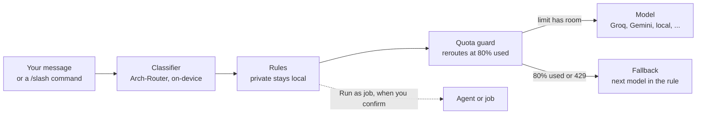

A manual pick or a slash command skips the classifier. Every hop is logged, and **Why this?** shows the rule,
the score and what was skipped and why.

</details>

## Quickstart

Four steps. Open one at a time; each ends with a link to the next.

<details open>
<summary><b>1. Install</b></summary>

<details open>
<summary>Windows 11 + WSL2 (supported today)</summary>

You need: **WSL2 with Ubuntu 24.04** (systemd on), **Docker Desktop** with WSL integration, and **Ollama for
Windows** running. A GPU is optional: setup detects your VRAM and picks a local-model size (none, small, medium
or large). Clone into the WSL filesystem (`~`), not `/mnt/c`. In an Ubuntu terminal:

```bash
git clone https://github.com/DevelopingGod/switchboard.git ~/switchboard
```

```bash
cd ~/switchboard && scripts/setup-wsl.sh
```

```bash
scripts/doctor.sh
```

`setup-wsl.sh` installs Node (nvm), generates your secrets, starts Postgres, LiteLLM and the router in Docker, and
is safe to re-run. `doctor.sh` prints green/yellow/red for each piece and one fix per red. Then start the portal,
which listens on `127.0.0.1` only:

```bash
cd apps/portal && npm install && npm run build && npm start
```

Run these in a **new** Ubuntu terminal so the Linux Node from nvm comes first on `PATH` (a Windows Node can win and break `npm install`; the fix is in [docs/TROUBLESHOOTING.md](docs/TROUBLESHOOTING.md)). Then open <http://127.0.0.1:3000>.

<p align="center">
  <picture>
    <source media="(prefers-color-scheme: dark)" srcset="docs/media/shot-wizard-goals-dusk.webp">
    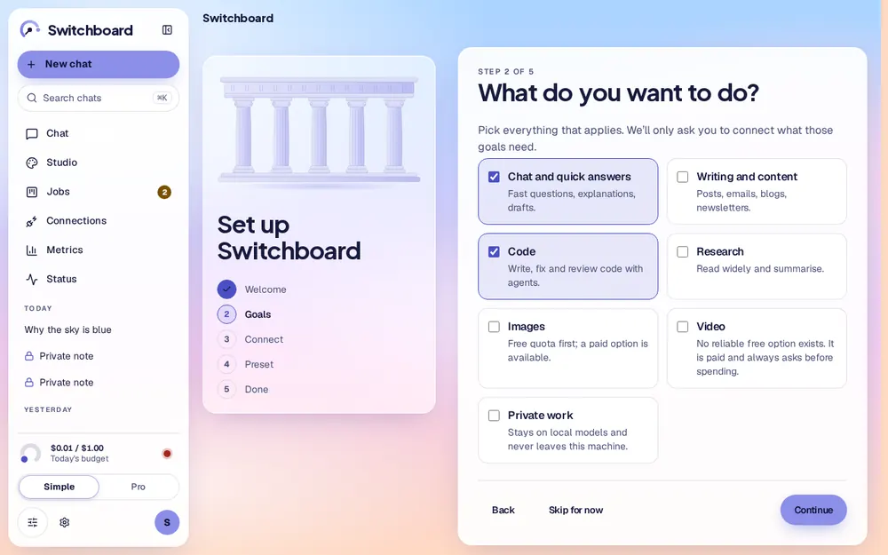
  </picture>
</p>

</details>

<details>
<summary>macOS and Linux (coming in M7)</summary>

One-command setup for macOS and Linux is planned for M7 (see the [roadmap](#roadmap)). The pieces are
cross-platform (Docker, Node, Python), but nothing outside Windows + WSL2 has been tried, so we don't claim it.

</details>

[Next: 2. Connect ↓](#connect)

</details>

<a id="connect"></a>

<details>
<summary><b>2. Connect</b> (paste a free key, or install a CLI)</summary>

The first-run wizard asks for your name and goals, then only the providers those goals need. Paste an API key and
press **Test**: it is checked against the provider before it is stored, then kept encrypted on your machine (the
UI only ever shows the last four characters). Start with a free one such as Groq or Google AI Studio. Each card
shows its free limits and whether the provider may train on your data. Agent CLIs (Claude Code, Codex, Gemini
CLI, Grok Build, OpenCode) can be installed from the same screen: you read the exact commands first and confirm, and
nothing runs with `sudo`. They are installed and login-checked today, and Claude Code, Codex and OpenCode run agent
jobs.

<p align="center">
  <picture>
    <source media="(prefers-color-scheme: dark)" srcset="docs/media/shot-wizard-connect-dusk.webp">
    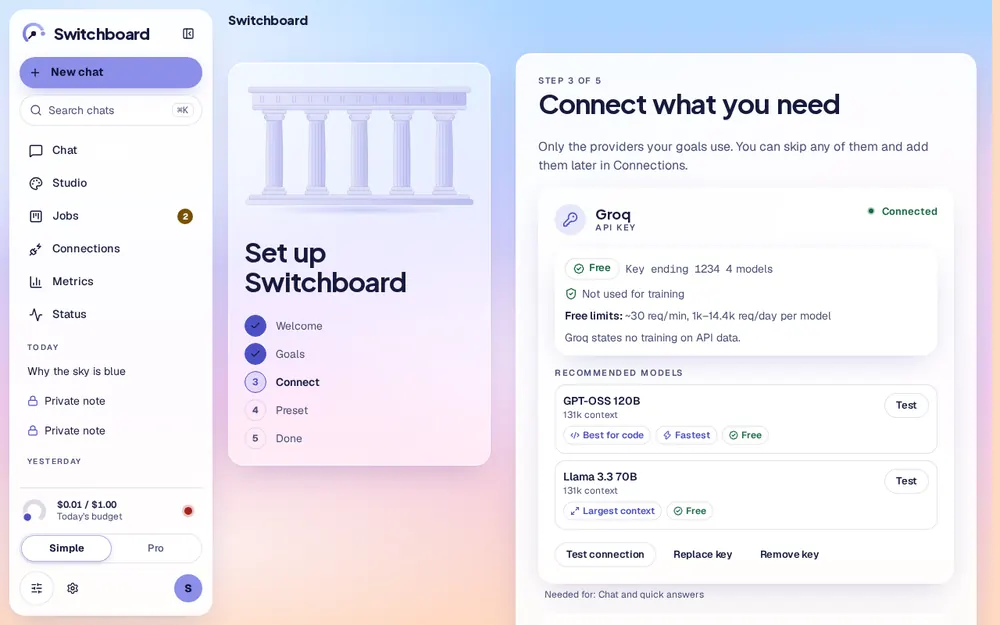
  </picture>
</p>

[Next: 3. Chat ↓](#chat)

</details>

<a id="chat"></a>

<details>
<summary><b>3. Chat</b></summary>

Leave **Target** on *Auto* and ask something. Click the route chip (**Why this?**) to see which model answered and
why. Type `/code`, `/research`, `/bulk` or `/private` to steer a single message, or flip the **Private** switch
to keep a whole chat on your machine. Private replies come from a local model that answers at once; press
**Think harder** for one message when it needs a slower model that reasons first. Attach images, PDFs, text or code
with the paperclip, by dropping them on the box, or by pasting a screenshot: the box shows roughly how many tokens
they will cost, a message with an image goes to a model that can read images, and a private image is read only by a
local model (or you are told none is set up). Press <kbd>Ctrl</kbd>/<kbd>⌘</kbd> + <kbd>K</kbd> anywhere to search.

<p align="center">
  <picture>
    <source media="(prefers-color-scheme: dark)" srcset="docs/media/shot-chat-why-dusk.webp">
    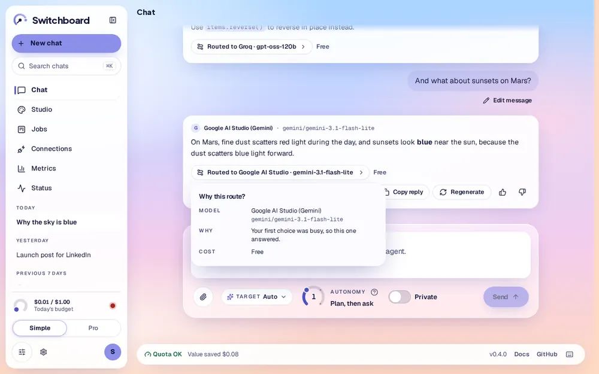
  </picture>
</p>

[Next: 4. Jobs ↓](#jobs)

</details>

<a id="jobs"></a>

<details>
<summary><b>4. Jobs</b></summary>

Add a repository in **Settings → Projects** (for example `~/code/myrepo`; never the Switchboard folder). Then ask
for code work in chat, for example "add a function and its tests", and press **Run as job** under the reply, or
press **New job** on the Jobs page. Pick the project, the agents in order (Claude Code, Codex or OpenCode; the next one
only steps in if the first can't start), the autonomy level and a budget, and read **What will happen** before
anything starts.

The agent works on a copy of the repo (a git worktree) on its own branch: it writes a plan, you approve it, it edits
the copy, and you review the changes file by file. Approving commits them on `switchboard/job-<n>`. **Nothing is
pushed**: the job page gives you the branch name and the `git` commands to review and merge it yourself. Jobs run
through [Paperclip](https://github.com/paperclipai/paperclip); a job that waits for you longer than a day (Settings →
Jobs) is stopped. Level 3 ("Full auto") stays off until its sandbox lands (coming in M7).

**Workflow packs** (Connections → Workflow packs, coming in M4.5a): with OpenSpec on for a project, a job runs
propose → apply → archive with a review after each step; graphify builds a local code graph for agent jobs on large
projects. Packs are pinned and hashed, set up only in the job's copy, and never committed unless you tick them.

<p align="center">
  <picture>
    <source media="(prefers-color-scheme: dark)" srcset="docs/media/shot-job-run-dusk.webp">
    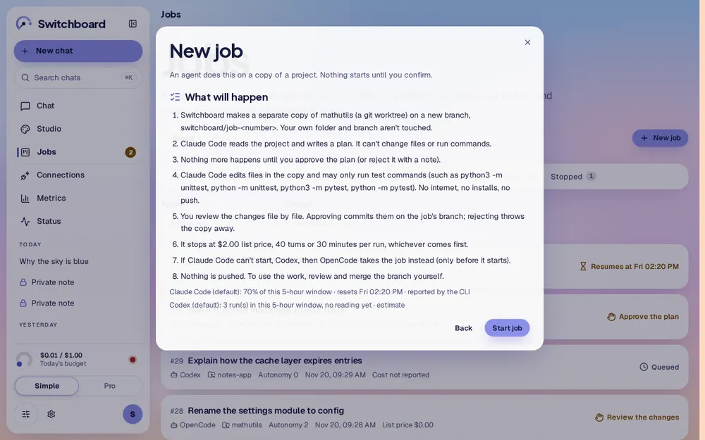
  </picture>
</p>

<p align="center">
  <picture>
    <source media="(prefers-color-scheme: dark)" srcset="docs/media/shot-job-diff-dusk.webp">
    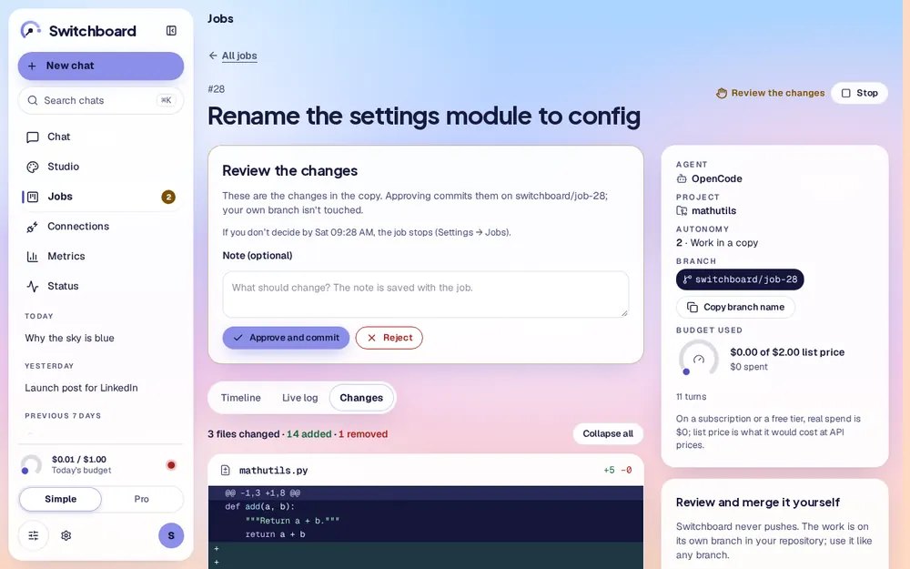
  </picture>
</p>

</details>

## Feature tour

Everything below ships today. Screenshots use fixture data (no real keys, chats or names) and follow your light/dark theme.

<table>
  <tr>
    <td width="50%" valign="top">
      <picture>
        <source media="(prefers-color-scheme: dark)" srcset="docs/media/shot-home-dusk.webp">
        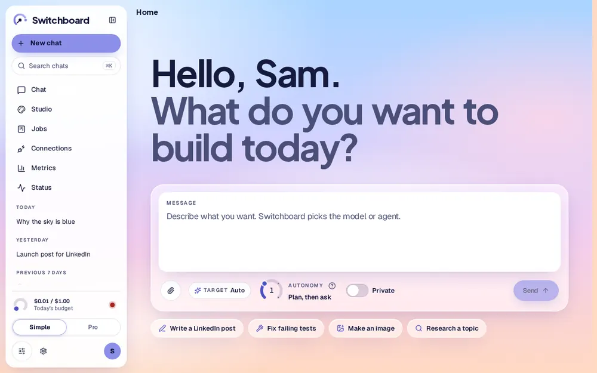
      </picture>
      <br><sub><b>One box for everything.</b> Quick starts, a target picker, an autonomy dial and a Private switch.</sub>
    </td>
    <td width="50%" valign="top">
      <picture>
        <source media="(prefers-color-scheme: dark)" srcset="docs/media/shot-chat-why-dusk.webp">
        
      </picture>
      <br><sub><b>Why this?</b> Every reply says which model answered and why, including what was skipped (Pro mode shows the scores).</sub>
    </td>
  </tr>
  <tr>
    <td width="50%" valign="top">
      <picture>
        <source media="(prefers-color-scheme: dark)" srcset="docs/media/shot-chat-private-dusk.webp">
        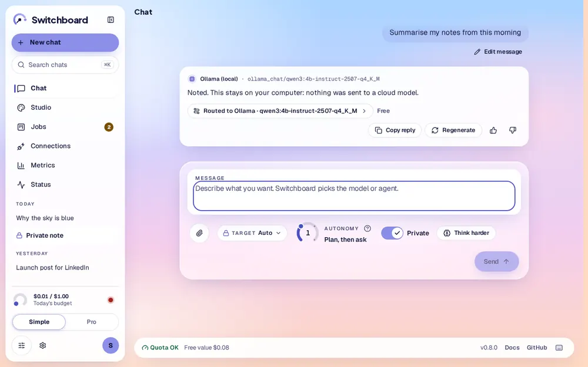
      </picture>
      <br><sub><b>Private chats stay local.</b> Only local models, no cloud fallback. Fast by default; Think harder when you need it.</sub>
    </td>
    <td width="50%" valign="top">
      <picture>
        <source media="(prefers-color-scheme: dark)" srcset="docs/media/shot-connections-dusk.webp">
        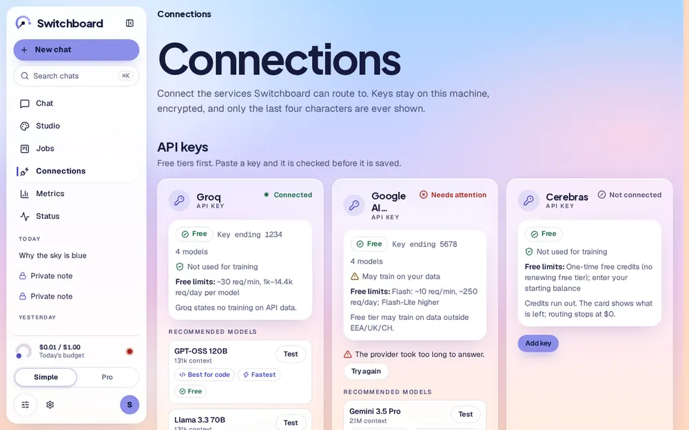
      </picture>
      <br><sub><b>Connections.</b> Add and test keys, see free limits and privacy labels, and get recommended models per provider.</sub>
    </td>
  </tr>
  <tr>
    <td width="50%" valign="top">
      <picture>
        <source media="(prefers-color-scheme: dark)" srcset="docs/media/shot-rules-dusk.webp">
        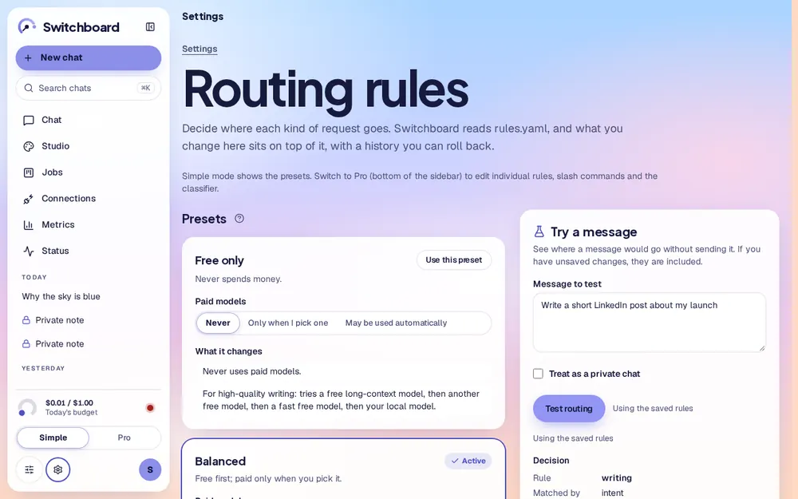
      </picture>
      <br><sub><b>Rules you can read and test.</b> Presets in Simple mode; a full rule editor with history and rollback in Pro. Dry-run any message first.</sub>
    </td>
    <td width="50%" valign="top">
      <picture>
        <source media="(prefers-color-scheme: dark)" srcset="docs/media/shot-wizard-goals-dusk.webp">
        
      </picture>
      <br><sub><b>A guided first run.</b> Skippable, resumable, and it only asks for the providers your goals need.</sub>
    </td>
  </tr>
  <tr>
    <td width="50%" valign="top">
      <picture>
        <source media="(prefers-color-scheme: dark)" srcset="docs/media/shot-chat-attach-dusk.webp">
        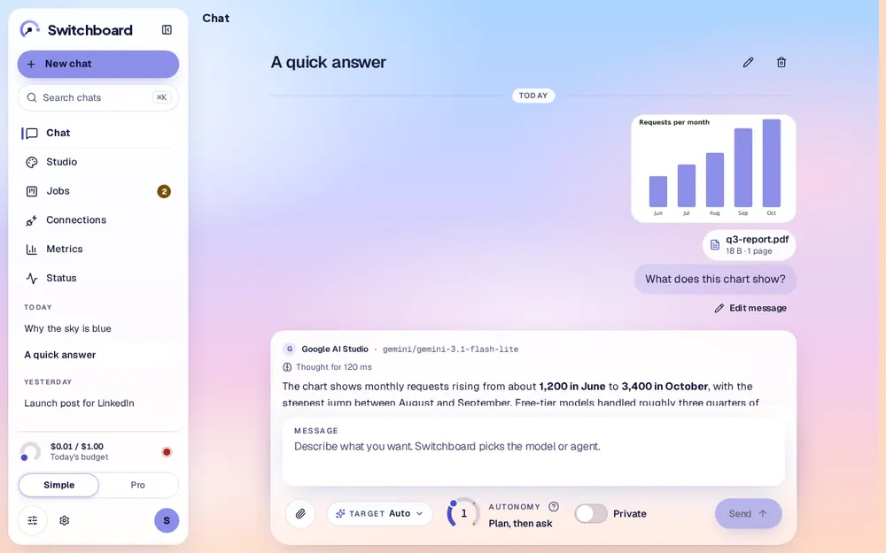
      </picture>
      <br><sub><b>Files and images.</b> Attach, drop or paste. Images go to a model that can read them; private images stay on your computer; files never run.</sub>
    </td>
    <td width="50%" valign="top">
      <picture>
        <source media="(prefers-color-scheme: dark)" srcset="docs/media/shot-activity-dusk.webp">
        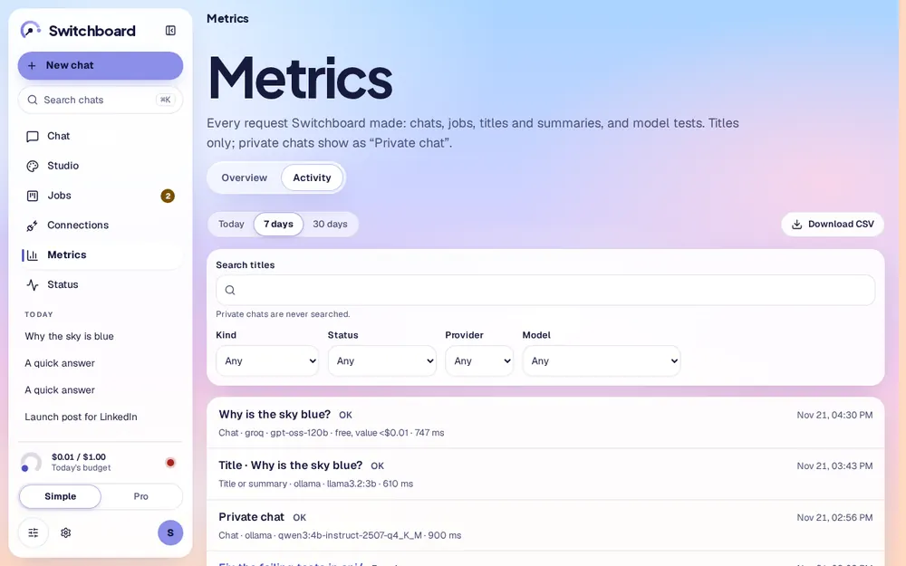
      </picture>
      <br><sub><b>Activity.</b> Every request in one list: chats, jobs, titles and model tests. Search titles, filter, open "Why this?", export CSV.</sub>
    </td>
  </tr>
</table>

<table>
  <tr>
    <td width="50%" valign="top">
      <picture>
        <source media="(prefers-color-scheme: dark)" srcset="docs/media/shot-jobs-board-dusk.webp">
        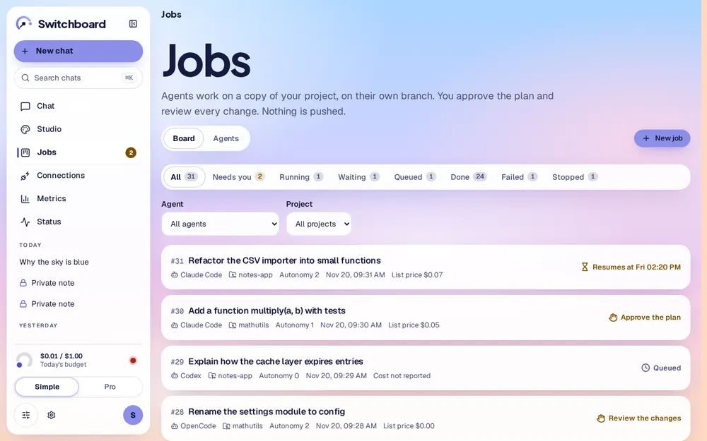
      </picture>
      <br><sub><b>Jobs.</b> Agents work on a copy of your repo on their own branch; you approve the plan and review every change. Nothing is pushed.</sub>
    </td>
    <td width="50%" valign="top">
      <picture>
        <source media="(prefers-color-scheme: dark)" srcset="docs/media/shot-agents-dusk.webp">
        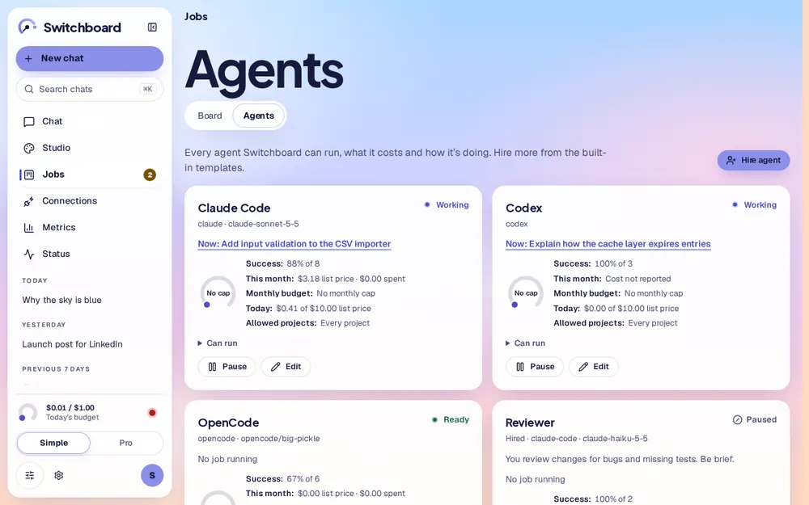
      </picture>
      <br><sub><b>Your agent fleet.</b> Hire agents from Claude Code, Codex or OpenCode with a role, model, budget, account and allowed projects; see each subscription's usage window.</sub>
    </td>
  </tr>
  <tr>
    <td width="50%" valign="top">
      <picture>
        <source media="(prefers-color-scheme: dark)" srcset="docs/media/shot-job-plan-dusk.webp">
        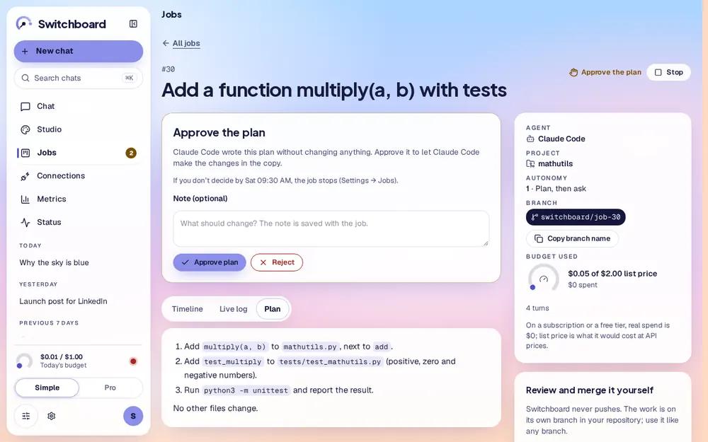
      </picture>
      <br><sub><b>Plan first.</b> At the default level the agent changes nothing until you approve its plan.</sub>
    </td>
    <td width="50%" valign="top">
      <picture>
        <source media="(prefers-color-scheme: dark)" srcset="docs/media/shot-job-diff-dusk.webp">
        
      </picture>
      <br><sub><b>Review every change.</b> Per-file diffs, the live log, cost (or "cost not reported"), and the branch with plain merge instructions.</sub>
    </td>
  </tr>
  <tr>
    <td width="50%" valign="top">
      <picture>
        <source media="(prefers-color-scheme: dark)" srcset="docs/media/shot-job-waiting-dusk.webp">
        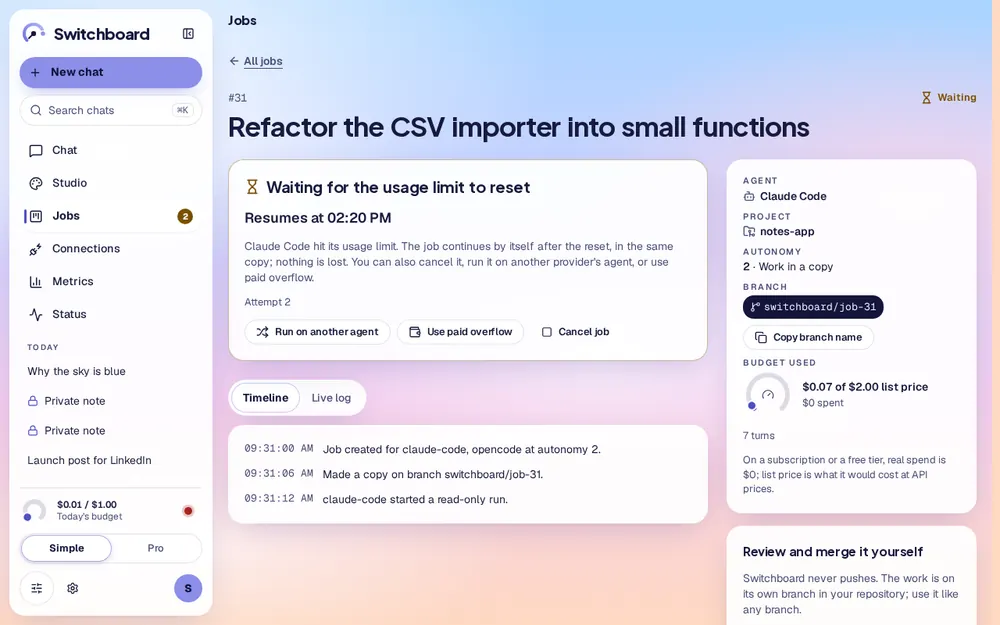
      </picture>
      <br><sub><b>Limits don't lose work.</b> A job that hits a subscription limit waits for the reset and carries on in the same copy. Or run it on another provider, or opt in to paid overflow.</sub>
    </td>
    <td width="50%" valign="top">
      <picture>
        <source media="(prefers-color-scheme: dark)" srcset="docs/media/shot-accounts-dusk.webp">
        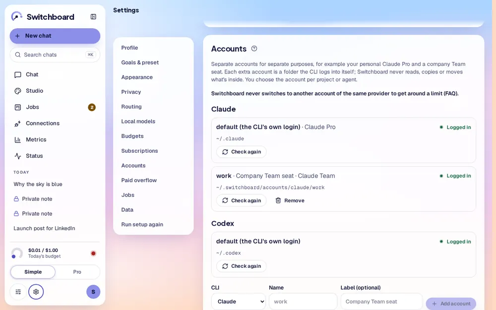
      </picture>
      <br><sub><b>Separate accounts, never rotated.</b> Keep a personal plan and a company seat apart, per project or agent. Each usage window is shown, reported by the CLI or labelled as an estimate.</sub>
    </td>
  </tr>
  <tr>
    <td width="50%" valign="top">
      <picture>
        <source media="(prefers-color-scheme: dark)" srcset="docs/media/shot-packs-dusk.webp">
        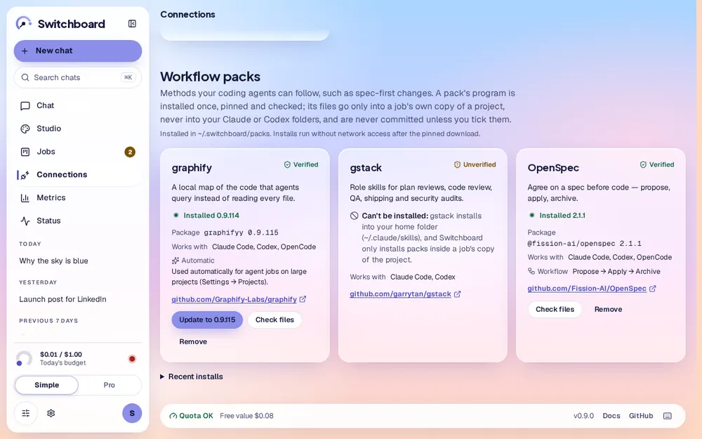
      </picture>
      <br><sub><b>Workflow packs.</b> OpenSpec's propose → apply → archive as one job, and graphify's code graph. Pinned and hashed, set up only in the job's copy, never committed unless you tick it.</sub>
    </td>
  </tr>
</table>

<table>
  <tr>
    <td width="50%" valign="top">
      <picture>
        <source media="(prefers-color-scheme: dark)" srcset="docs/media/shot-metrics-dusk.webp">
        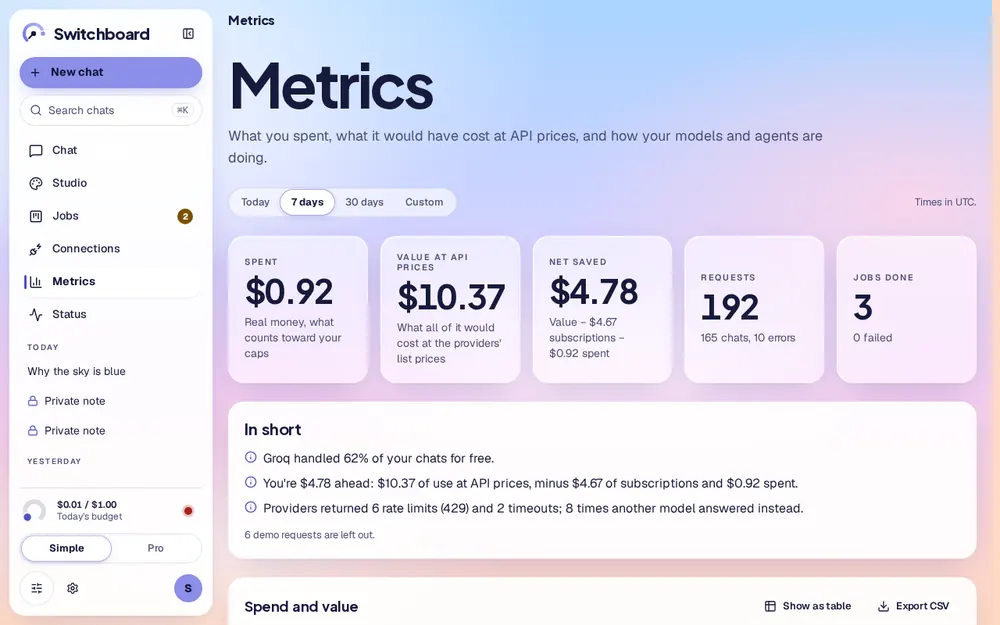
      </picture>
      <br><sub><b>Metrics.</b> Chat, agent jobs and every LiteLLM call in one place, counted once. Net saved is after your subscription fees, never just list price.</sub>
    </td>
    <td width="50%" valign="top">
      <picture>
        <source media="(prefers-color-scheme: dark)" srcset="docs/media/shot-metrics-pro-dusk.webp">
        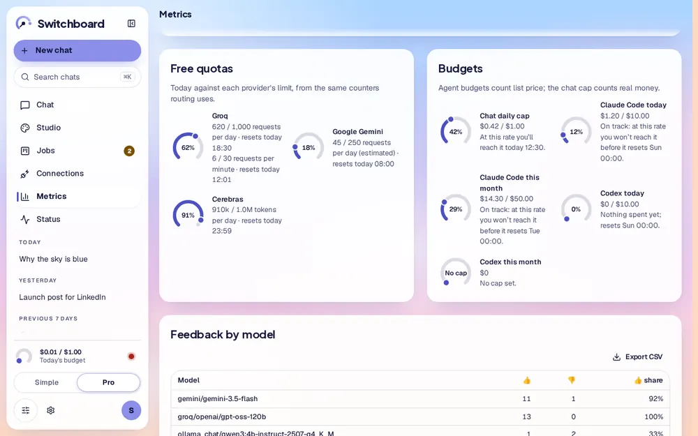
      </picture>
      <br><sub><b>Pro view.</b> Breakdowns by provider, model, agent, rule, intent and project; errors, latency, quotas and budget forecasts. Every chart has a table view and CSV export.</sub>
    </td>
  </tr>
</table>

Also shipping: a quota guard with footer and Status readouts, long-thread summaries, a model catalog with recommended
models, thread search, pinning and export, self-healing sync with plain-language errors, Simple and Pro modes,
Day and Dusk themes, and local-model profiles matched to your GPU.

## Privacy and security

- **Local by default.** The portal, router and gateway bind to `127.0.0.1`, and `doctor.sh` goes red if the portal listens on any other interface.
- **Keys stay server-side.** Provider keys are encrypted in your own database and never sent to the browser or logged
  (only the last four characters are shown). A test builds the portal with a sentinel token and fails if it appears in client code.
- **Private means private.** A private chat can only use local models; there is no cloud fallback, and a test
  captures every outgoing call to prove it. Messages that look sensitive (health, finance, legal, personal) are kept local with a one-click override,
  and pasted secrets always stay local and are masked in everything stored.
- **No subscription token passthrough.** Subscriptions are used only through each vendor's own official CLI.
  Switchboard never extracts a login and hands it to another tool, because that risks your account.
- **Agents are fenced in.** Jobs run only in folders you add to the Projects allowlist (never the Switchboard repo
  itself), in their own git worktree on a new branch, never on your checked-out branch. Nothing is pushed: each agent's
  permissions, a sandbox without network (Codex) and a git setting in its environment all block it. Agents get no
  Switchboard keys, no SSH agent and no GitHub login, and every job has a budget, a turn cap and time limits.
  Switchboard and Paperclip never copy, read, move or write a CLI's login files.
- **Never `sudo`.** Installers are pinned, downloaded to a file, hashed and shown to you before they run.
- **Known limit: the portal has no login yet.** Anyone who can reach port 3000 has full access, which is why it
  listens on loopback only. **Don't expose it to a network** until login lands (M7). Paperclip, which runs the agents,
  has no login either in its local mode: doctor and Status check that it listens on `127.0.0.1` only.
- Some free tiers (for example Gemini's) may train on your prompts. Each provider card says so; use **Private** for anything you wouldn't send them.

## How it compares

*As of 2026-11-19, from each project's public docs and listings. We have not run them side by side, so cells say
"not stated" where we could not confirm. These are different tools for different jobs; several pair well with Switchboard.*

| | What it is | Routes across providers automatically | Explains each routing choice | Subscription logins | License |
|---|---|---|---|---|---|
| **Switchboard** | Chat portal + router for free tiers, subscriptions and local models | Yes: rules, an on-device classifier and a quota guard | Yes ("Why this?") | Official vendor CLIs only (used for agent jobs) | MIT |
| [Open WebUI](https://github.com/open-webui/open-webui) | Self-hosted chat UI for Ollama and OpenAI-compatible APIs, with built-in RAG | Not stated | Not stated | n/a | Custom "Open WebUI License" with a branding clause |
| [OmniRoute](https://github.com/diegosouzapw/OmniRoute) | AI gateway with tiered fallback (subscription, API key, cheap, free) | Yes (fallback tiers) | Not stated | Routes subscription logins through the gateway, per its project description | MIT, per its listings |
| [9Router](https://github.com/decolua/9Router) | Local OpenAI-compatible endpoint for coding agents with three-tier fallback | Yes (fallback tiers) | Not stated | Routes subscription logins through its endpoint, per its project description | MIT, per its listings |
| [Paperclip](https://github.com/paperclipai/paperclip) | Agent orchestration: org charts, tickets, per-agent budgets (not a chat app or router) | No (it runs your agents) | n/a | Via agent adapters | MIT |
| [Ollama app](https://ollama.com) | Desktop chat for local models, with optional cloud models | No | n/a | n/a | See the project |

Switchboard uses Paperclip to run its agent jobs rather than rebuild it. We chose not to route subscription logins
through a gateway (see [Privacy](#privacy-and-security)); that is a decision about account risk, not a claim about other projects.

## Roadmap

✅ shipped · 🔜 planned or in progress · 💡 idea. Status follows [docs/PROGRESS.md](docs/PROGRESS.md), which is the source of truth.

<!-- roadmap:start -->
| | Milestone | What it is |
|---|---|---|
| ✅ | **M0** Infrastructure | Postgres, LiteLLM, Ollama, Paperclip, `doctor.sh` |
| ✅ | **M0.5** Design system | "Dreamy sky" kit, Day and Dusk themes, accessible and fast |
| ✅ | **M1a** Router backend | Connections API, model catalog, CLI detection and install |
| ✅ | **M1b** Connections and wizard | Add and test keys, install CLIs, first-run wizard |
| ✅ | **M2** Chat and rules | Streaming chat, rules engine, fallbacks with reasons, caps, private |
| ✅ | **M1.5** Polish and self-healing | Footer, Status, settings, self-healing LiteLLM sync |
| ✅ | **M3a** Routing brain | On-device classifier, recommender, quota guard, summaries, auto-private |
| ✅ | **M3b** Rules UI and sidebar | Rules editor with history, dry-run tester, left sidebar, small-GPU profile |
| ✅ | **M4a** Agents and jobs backend | Agent registry, jobs through Paperclip with approvals, worktrees and budgets; fast private chat |
| ✅ | **M4b** Jobs page and agent fleet | Job board, live log, plan and diff review, Run as job from chat, hire and manage agents, Projects |
| ✅ | **M6** Metrics | One dashboard for spend, honest savings, quotas, budgets, errors and latency, with CSV export |
| ✅ | **M6.5** Subscription windows | See each subscription's usage window, jobs that wait for a reset and continue, separate accounts for separate purposes, opt-in paid overflow |
| ✅ | **M2.5** Attachments and Activity log | Attach files and images in chat (button, drag-and-drop, paste); private attachments stay on your machine; attachments in jobs; a searchable list of every request |
| 🔜 | **M4.5a** Workflow packs foundation | Install spec and review workflows on demand, from the UI: pinned and hashed, set up only inside a job's copy of the project, never committed without your say. OpenSpec runs propose → apply → archive in one job; graphify builds a local code graph for agent jobs on large projects and turns itself off where it doesn't save tokens |
| 🔜 | **M4.5a-2** Private projects | Mark a project private: every step, including the agent, stays on your machine; graphify's optional AI pass |
| 🔜 | **M4.5b** Workflow packs: routing and UI | A different agent or model per workflow phase, command chips in the composer, proposal cards, project presets, more packs |
| 🔜 | **M5.5** Content Studio | Drafts, voice profiles, media pairing, export |
| 🔜 | **M5** Studio | Image and video generation with cost confirmation: local Stable Diffusion for small GPUs, Grok Imagine as a paid opt-in, honest labels |
| 🔜 | **M6.7** Local compute optimizer | Use every GPU (NVIDIA and AMD iGPU), see how each local model splits between GPU and RAM, a fit advisor and tuning |
| 🔜 | **M6.8** Custom providers and presets | Add any OpenAI-compatible provider, including local servers, with safety checks; presets for Cloudflare, NVIDIA, Ollama Cloud and Antigravity; YAML export and import |
| 🔜 | **M6.9** Quiet beta | 5–10 users try real installs before launch |
| 🔜 | **M7** Launch | One-command install on macOS and Linux, portal login, sandboxed full-auto jobs, CI, v1.0.0, a GitHub Pages site and a short promo video |
<!-- roadmap:end -->

This is the full road to launch; there is no "later" bucket. 💡 Ideas that come up now go to the
[v1.1 list](docs/PROGRESS.md#v11-list).

## FAQ

<details>
<summary>Is it really free?</summary>

The software is MIT-licensed and free. Models cost whatever your providers charge: free tiers have limits, and
Switchboard tries to spend those first and keeps paid models behind your approval (a per-request and a daily cap apply to paid use).

</details>

<details>
<summary>Does it use my ChatGPT, Claude or Grok subscription?</summary>

Only through each vendor's official CLI, and only for agent jobs, which you start and approve on the Jobs page.
Switchboard and Paperclip never copy, read, move or write a CLI's login files, and never pass a subscription login to
another tool.

</details>

<details>
<summary>Does Switchboard rotate multiple accounts to get around limits?</summary>

No — it falls back to other providers, resumes after resets, and can use paid overflow if you opt in.

</details>

<details>
<summary>Where does my data go?</summary>

Chats, rules and settings live in a Postgres database on your machine; attached files in a folder next to it
(`~/.switchboard/data`, readable only by you). A message goes to the provider it is routed to (the chip tells you
which), unless the chat is private or looks sensitive, in which case it stays on your machine. That includes its
attachments: a private image is read only by a local model, and a file with a secret in it keeps the chat local.

</details>

<details>
<summary>How good is the automatic routing?</summary>

On our own labelled set of 80 prompts the on-device classifier is right 96.2% of the time, and 92.5% on the half
we did not tune on. That set is small and ours, so treat it as a sanity check, not a benchmark
([details](docs/m3a.md)). You can always pick a target yourself, and **Why this?** shows what happened.

</details>

<details>
<summary>Can I add another provider?</summary>

Providers live in YAML ([config/providers.yaml](config/providers.yaml)). Any OpenAI-compatible API can be added
with config only; a test proves it. We have not shipped a provider that way yet.

</details>

<details>
<summary>macOS or Linux?</summary>

Planned for M7. The stack is cross-platform but only Windows + WSL2 has been tried.

</details>

## Contributing

Bug reports, provider and model config fixes, and docs are the most useful right now. Read
[CONTRIBUTING.md](CONTRIBUTING.md), [SPEC.md](SPEC.md) and [docs/PROGRESS.md](docs/PROGRESS.md) first.

## License

[MIT](LICENSE) © 2026 DevelopingGod

## Star history

<a href="https://star-history.com/#DevelopingGod/switchboard&Date">
  <picture>
    <source media="(prefers-color-scheme: dark)" srcset="https://api.star-history.com/svg?repos=DevelopingGod/switchboard&type=Date&theme=dark">
    
  </picture>
</a>
