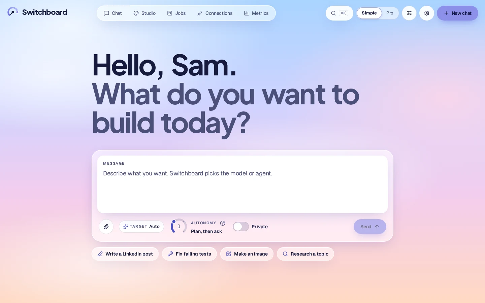
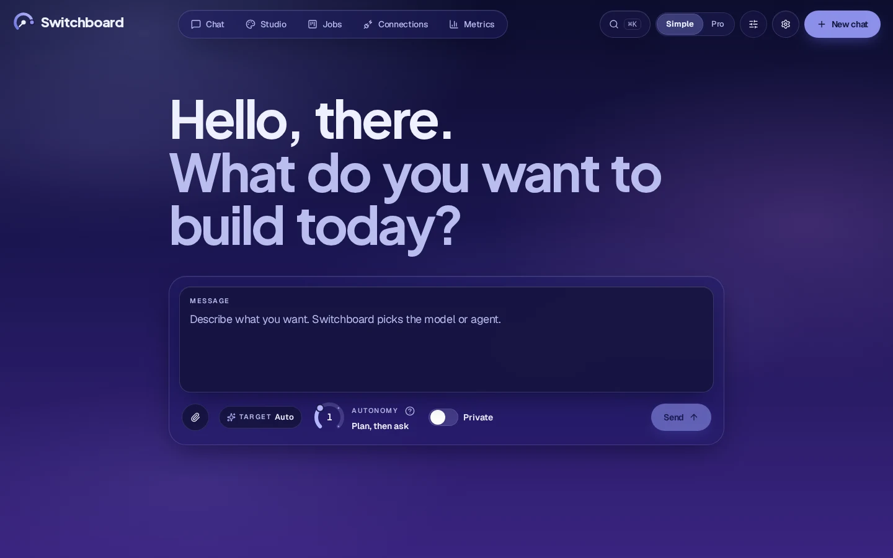

# M0.5 — Design system and app shell

`apps/portal` (Next.js 16, TypeScript, Tailwind 4, shadcn/ui-style primitives on Radix, Motion, Lucide). Spec: [SPEC §8c](../SPEC.md).




More captures (full gallery, optional sky image) are in [`docs/screens/`](screens/).

## Run

```bash
source ~/.nvm/nvm.sh        # Linux Node 24 (see docs/TROUBLESHOOTING.md)
cd apps/portal
npm install
npm run dev                 # http://localhost:3000  (3100 is Paperclip)
```

Open `/dev/components` for every component in every state. Theme, density, Simple/Pro, solid surfaces and sky image are in the toolbar (or ⌘K).

Test-only URL overrides (also read by the pre-paint script): `?theme=light|dark&density=compact&solid=1&sky=image&mode=pro`.

## Design tokens

`src/design/design-tokens.ts` is the only place colors, blur, radius, motion and density are defined. `npm run gen:tokens` (runs automatically before `dev` and `build`) emits `src/design/tokens.generated.css`; a unit test fails if the committed file drifts. Tailwind utilities (`bg-glass-strong`, `text-ink-muted`, `rounded-panel`...) map to those variables in `src/app/globals.css`.

Custom component classes (`.glass`, `.surface-strong`, `.shimmer`, `.display`...) live in `src/app/components.css`, imported with `layer(components)` so Tailwind utilities can override them. (Plain `@layer components { }` blocks inside `globals.css` were flattened to unlayered CSS by the Turbopack build, which silently broke `rounded-*` overrides.)

## Component kit (`src/components/kit`)

GlassPanel, PillTabs, Dial, StatCard, RouteChip, ProviderCard, JobCard, CostBadge, ExplainPopover, Composer, Toast, Skeleton, EmptyState, plus StatusBadge, Segmented, Logo, ColumnsArt, SkyBackground. Primitives (Button, Popover, Switch) are in `src/components/ui`.

Every component takes `state: default | loading | empty | error | disabled` where it makes sense. Status is always icon + text + color. All strings come from `src/i18n/strings.ts` (the gallery's own section titles and sample data are dev fixtures and stay inline).

## Checks

Build first, the tests run against the production server on port **3210** (Playwright starts it):

```bash
npm run build
npm test                   # vitest: AA contrast for every text/surface pair in both themes, token sync, sky < 150 KB
npm run test:a11y          # axe on /, /chat, /settings, /dev/components (both themes), palette, popovers, mobile
npx playwright test tests/shell.spec.ts   # palette, Simple/Pro, Dial keyboard, reduced-transparency/motion, <= 2 blur layers
npm run test:visual        # 34 screenshots (15 components + shell, both themes)
npm run budget             # initial JS per route, gzip, < 200 KB
npm run lighthouse         # performance / accessibility / best-practices >= 90 (SEO excluded)
npm run screens            # regenerate docs/screens/*.webp
```

Update visual baselines intentionally with `npm run test:visual:update` and review the diff. Baselines are rendered by the Playwright Chromium on Linux (`*-linux.png`); regenerate them on the same platform.

First-time Playwright setup needs system libraries (needs sudo): `sudo npx playwright install-deps chromium`.

## Performance notes

- Motion loads through `LazyMotion` (`domMax` after first paint); the command palette (cmdk + Radix Dialog) loads on first ⌘K; Radix Popover loads right after hydration behind an identical static trigger.
- Gallery sections use `content-visibility: auto`.
- `scripts/lighthouse.mts` runs Lighthouse from a scratch directory: under WSL, chrome-launcher creates `C:\Users\...` profile directories relative to the cwd.

## Sky image

`npm run gen:sky` paints `public/sky/day.avif` and `dusk.avif` procedurally (gradients plus fractal-noise clouds, rendered with sharp). Original artwork, about 6 KB each.
